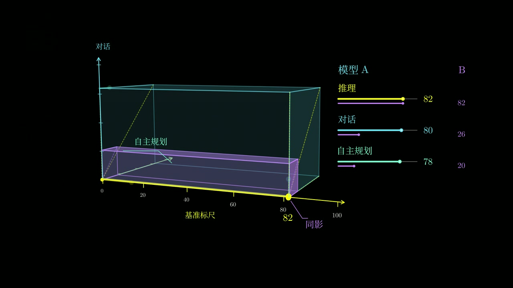

# 能力的影子

两个模型都得了 82 分。把它们转个面，才发现这个分数漏掉了什么。
这部中文动画讲 [Stanford CS336 第 12 讲](https://stanford-cs336.github.io/spring2025/)：从困惑度、标准考卷和人类盲测，一路走到软件沙箱与训练数据污染。

**v6.2 终版 · 31:45.5 · 1080p / 60 fps · 9 章。** 公开版带中文字幕，无音轨。

[下载无声字幕全片](https://github.com/siddhartha-yz/cs336-lecture12-evaluation/releases/download/v6.2.0/cs336-l12-zh-picture-only.mp4) · [下载含 35 个无声镜头的复剪工程](https://github.com/siddhartha-yz/cs336-lecture12-evaluation/releases/download/v6.2.0/cs336-l12-zh-editing-kit.zip) · [查看 v6.2 发布页](https://github.com/siddhartha-yz/cs336-lecture12-evaluation/releases/tag/v6.2.0)



## 从一镜继续

克隆仓库后，直接画一帧困惑度的问句过渡：

```sh
cd editions/zh-v6.2
/usr/bin/python3 复剪.py --still door2 2.35 --out build/困惑度过渡.png
```

要接回整条片子，用上面的复剪包。35 条无字幕切片可直接拖进编辑器，也可用 `python3 复剪.py --assemble-silent` 拼回带可切换字幕的无声全片。

[复剪说明](editions/zh-v6.2/README.md) · [逐字稿与章节](editions/zh-v6.2/film/film_zh_v6/edition/CS336-L12-能力的影子-v6.2-逐字稿与章节.md) · [中文字幕](editions/zh-v6.2/film/film_zh_v6/edition/CS336-L12-能力的影子-v6.2.srt) · [数据与素材出处](editions/zh-v6.2/film/film_zh_v6/edition/CS336-L12-能力的影子-v6.2-数据与配乐.md) · [配乐时间表](editions/zh-v6.2/film/film_zh_v6/audio/cuebook.json)

## 上一次全片存档 · v3.1.0

21 分 28 秒，33 镜。[无声全片与分镜包](https://github.com/siddhartha-yz/cs336-lecture12-evaluation/releases/tag/v3.1.0) · [当时的工程与说明](editions/zh-v3)

## 早期版本 · v0.1.0

| 版本 | 已经做到哪里 | 编辑入口 |
|---|---|---|
| **Beat 0–1 中文版** · 3:48 | 中文图文、普通话旁白、可开关中文字幕。该版使用 Qwen3‑TTS 的 Dylan。 | [中文逐字稿](film/beats_zh/narration-zh.md) · [分镜与时间轴](film/beats_zh) · [数据出处](film/beats_zh/release_sources.md) |
| **Beat 0–1 英文版** · 3:44 | 从 Goodhart 定律、帕累托前沿、Arena 讲到 NanoGPT 的 3.28 验证损失目标。保留原定英文稿及两处局部修订。 | [英文逐字稿](film/beats_final/en-verbatim.txt) · [分镜](film/beats_final) · [数据出处](film/beats_final/sources.md) |
| **Beat 2 英文版** · 4:15 | 从上一段的八个词元接入困惑度，比较 PPL / BPB、答案正确性与 Paloma 分域得分。单段与 0–2 合辑均有中文字幕。 | [英文稿](film/beat2/en.txt) · [逐词元数据](film/beat2/verified-data.json) · [分镜与来源](film/beat2/sources.md) |
| **全讲早期版** · 中、英各 20:00 | 四幕完整内容和剪辑底稿。后续精剪是独立版本；两部 20 分钟成片仍保留各自当时的开头。 | [中文四幕](film) · [英文四幕](film/v2) · [英文全片逐字稿](film/v2/narration-en.txt) |

[早期成片与剪辑素材](https://github.com/siddhartha-yz/cs336-lecture12-evaluation/releases/tag/v0.1.0) · [早期工程还原说明](docs/editing.md)
