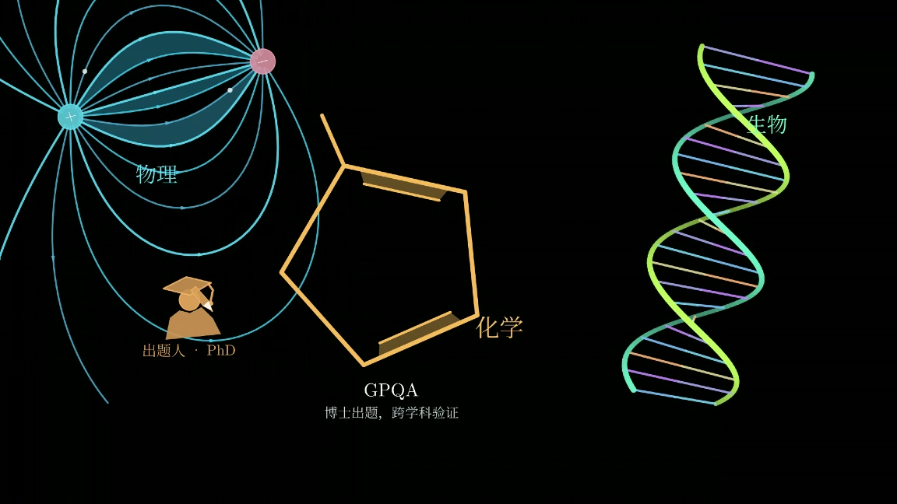

# 模型评测：我们在量什么？

同一个模型，算答对几题、每题花多少钱、观众更喜欢哪份回答，能得到三个不同的名次。这部动画从一把只能看见投影的尺子出发，讲 [Stanford CS336 第 12 讲](https://cs336.stanford.edu/spring2025/) 的核心问题：每换一把尺，究竟多量到了什么？

**当前版 v3.1.0：Beat 0–8 全片，21 分 28 秒，1080p / 60 fps。** 本次公开的是无声画面，中文字幕已印在片中。逐字稿、字级时码与本地连续配乐版一致。

[下载无声字幕全片](https://github.com/siddhartha-yz/cs336-lecture12-evaluation/releases/download/v3.1.0/cs336-l12-zh-picture-only.mp4) · [下载分镜工程（含 33 个无声镜头）](https://github.com/siddhartha-yz/cs336-lecture12-evaluation/releases/download/v3.1.0/cs336-l12-zh-editing-kit.zip) · [阅读逐字稿](editions/zh-v3/逐字稿与章节.md)



## 从一个镜头继续

在克隆的仓库里运行下列命令，可直接画出 GPQA 一帧。要接着剪全片，用上面的分镜包：里面除了相同的源码和资料，还有全部干净切片；重画哪一镜，就替换哪一镜。

```bash
cd editions/zh-v3
/usr/bin/python3 复现.py --still 3-3 28.0 --width 1280
```

[编辑与装配方法](editions/zh-v3/README.md) · [逐问剪辑单与动效蓝图](editions/zh-v3/问句精简与动效蓝图.md) · [字幕](editions/zh-v3/中文字幕.srt) · [数据、图片与曲目出处](editions/zh-v3/数据与配乐.md) · [连续配乐剪辑时码](editions/zh-v3/film/film_zh_v3/audio/cuebook.json)

## 早期版本 · v0.1.0

| 版本 | 已经做到哪里 | 编辑入口 |
|---|---|---|
| **Beat 0–1 中文版** · 3:48 | 中文图文、普通话旁白、可开关中文字幕。该版使用 Qwen3‑TTS 的 Dylan。 | [中文逐字稿](film/beats_zh/narration-zh.md) · [分镜与时间轴](film/beats_zh) · [数据出处](film/beats_zh/release_sources.md) |
| **Beat 0–1 英文版** · 3:44 | 从 Goodhart 定律、帕累托前沿、Arena 讲到 NanoGPT 的 3.28 验证损失目标。保留原定英文稿及两处局部修订。 | [英文逐字稿](film/beats_final/en-verbatim.txt) · [分镜](film/beats_final) · [数据出处](film/beats_final/sources.md) |
| **Beat 2 英文版** · 4:15 | 从上一段的八个词元接入困惑度，比较 PPL / BPB、答案正确性与 Paloma 分域得分。单段与 0–2 合辑均有中文字幕。 | [英文稿](film/beat2/en.txt) · [逐词元数据](film/beat2/verified-data.json) · [分镜与来源](film/beat2/sources.md) |
| **全讲早期版** · 中、英各 20:00 | 四幕完整内容和剪辑底稿。后续精剪是独立版本；两部 20 分钟成片仍保留各自当时的开头。 | [中文四幕](film) · [英文四幕](film/v2) · [英文全片逐字稿](film/v2/narration-en.txt) |

[早期成片与剪辑素材](https://github.com/siddhartha-yz/cs336-lecture12-evaluation/releases/tag/v0.1.0) · [早期工程还原说明](docs/editing.md)
