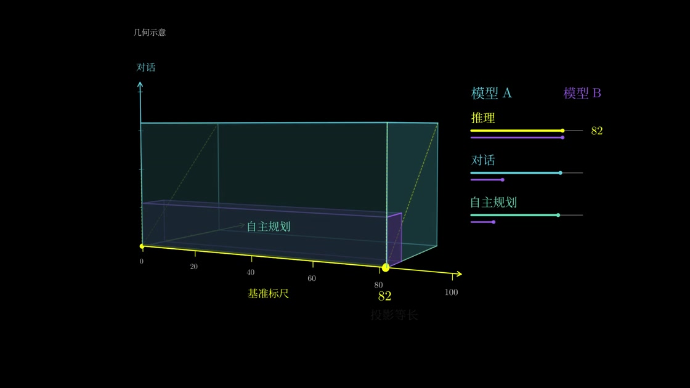

# 模型评估：我们在量什么？

同一个模型，基准分数、每题成本、盲测偏好和实际用量能给出四个不同名次。这是对 [Stanford CS336 第 12 讲 · Evaluation](https://cs336.stanford.edu/spring2025/) 的独立动画讲解。分镜用 Python、Cairo 和 Pango 绘制，按口播时间驱动，输出 1080p / 30 fps。

[看中文开头 · 3:48](https://github.com/siddhartha-yz/cs336-lecture12-evaluation/releases/download/v0.1.0/beats-0-1-zh.mp4) · [看英文精剪 · 7:59](https://github.com/siddhartha-yz/cs336-lecture12-evaluation/releases/download/v0.1.0/beats-0-2-en.mp4) · [全部视频与剪辑音轨](https://github.com/siddhartha-yz/cs336-lecture12-evaluation/releases/tag/v0.1.0)



## 从哪一版继续？

| 版本 | 已经做到哪里 | 编辑入口 |
|---|---|---|
| **Beat 0–1 中文版** · 3:48 | 中文图文、普通话旁白、可开关中文字幕。当前片中是 Qwen3‑TTS 的 Dylan；新的真人参考声线还在挑选。 | [中文逐字稿](film/beats_zh/narration-zh.md) · [分镜与时间轴](film/beats_zh) · [数据出处](film/beats_zh/release_sources.md) |
| **Beat 0–1 英文版** · 3:44 | 从 Goodhart 定律、帕累托前沿、Arena 讲到 NanoGPT 的 3.28 验证损失目标。保留原定英文稿及两处局部修订。 | [英文逐字稿](film/beats_final/en-verbatim.txt) · [分镜](film/beats_final) · [数据出处](film/beats_final/sources.md) |
| **Beat 2 英文版** · 4:15 | 从上一段的八个词元接入困惑度，比较 PPL / BPB、答案正确性与 Paloma 分域得分。单段与 0–2 合辑均有中文字幕。 | [英文稿](film/beat2/en.txt) · [逐词元数据](film/beat2/verified-data.json) · [分镜与来源](film/beat2/sources.md) |
| **全讲早期版** · 中、英各 20:00 | 四幕完整内容和剪辑底稿。后续精剪是独立版本；两部 20 分钟成片仍保留各自当时的开头。 | [中文四幕](film) · [英文四幕](film/v2) · [英文全片逐字稿](film/v2/narration-en.txt) |

**下一步只做试听。** 用选中的普通话真人录音，在本地 Fish Audio Drama 3 上读[开头约 30 秒的原稿](film/drama3/opening-zh.txt)。先听声音，再决定是否替换 Beat 0–1；此步不改画面、字幕或 Beat 2。[声源、模型版本与试听步骤 →](docs/voice.md)

## 在本地改一帧

Ubuntu / Debian：安装 `python3-cairo`、`python3-gi`、`python3-gi-cairo`、`gir1.2-pango-1.0`、`fonts-lmodern`、`fonts-noto-cjk` 和 `ffmpeg`。从仓库根目录运行：

```bash
/usr/bin/python3 film/beats_zh/film.py --width 960 --still b 18 build/projection.png
```

这里的 `18` 是镜头 B 内的秒数。改 [opening.py](film/beats_zh/opening.py) 再运行，就能看这幅投影。单帧及无声画面只需代码和锁定的数据，不下载模型。

[如何恢复音轨、重渲单个镜头和合成全片](docs/editing.md) · [配乐、素材与署名](docs/credits.md)
